= Eclipse JNoSQL REST with Open Liberty
:toc: macro
:toclevels: 2
:source-highlighter: highlight.js

Eclipse JNoSQL REST generates Jakarta REST endpoints directly from Jakarta Data repositories.
This example uses Open Liberty and Oracle NoSQL to demonstrate CRUD operations, pagination, dynamic queries, generated DTOs, and optional OpenAPI documentation.

*Define the repository. The framework generates the REST layer.*
For the operations it supports, you do not write any resource class by hand.

toc::[]

== Why This Example?

A typical REST service repeats the same code for every entity: a resource class, request and response objects, a mapper, and the wiring to the data layer.
Here, a single annotated `ProductRepository` interface replaces all of it.
At compile time, Eclipse JNoSQL REST generates:

* a Jakarta REST resource,
* request and response DTOs,
* a MapStruct mapper between the entity and the DTOs,
* a typed search request for dynamic queries.

NOTE: Automatic REST generation is an Eclipse JNoSQL extension. It is not part of the Jakarta Data specification.

== Architecture

At runtime, an HTTP client calls the generated resource in Open Liberty.
The resource converts data with the generated MapStruct mapper and delegates to the Jakarta Data repository, which stores the data in Oracle NoSQL.

Generation happens at compile time through annotation processing.
MapStruct is only a code generator and runs inside the application, not as a separate service.
OpenAPI is optional metadata produced from annotations and `openapi.yaml`; the application does not depend on it to serve requests.

The editable diagram source is link:docs/architecture.mmd[docs/architecture.mmd].
GitHub does not reliably render Mermaid in AsciiDoc, so the SVG is generated from it:

[source,bash]
----
npx @mermaid-js/mermaid-cli -i docs/architecture.mmd -o docs/architecture.svg
----

== Prerequisites

* Java 21
* Docker
* Maven, or the included Maven wrapper (`./mvnw`)

[source,bash]
----
java -version
----

== Getting Started

=== Start Oracle NoSQL

[source,bash]
----
docker run -d --name oracle-instance -p 8080:8080 ghcr.io/oracle/nosql:latest-ce
----

This starts Oracle NoSQL Community Edition in the background and exposes port 8080 on the host.
Check that the container is running:

[source,bash]
----
docker ps
docker logs oracle-instance
----

No further setup is needed.
The application reads its database settings from `src/main/resources/META-INF/microprofile-config.properties`:

[source,properties]
----
jnosql.keyvalue.database=products
jnosql.document.database=products
jnosql.oracle.nosql.host=http://localhost:8080
----

=== Run Open Liberty

[source,bash]
----
./mvnw liberty:dev
----

Liberty dev mode builds and starts the application and reloads it when the code changes.
The context root is `/jnosql-rest-openliberty` and the JAX-RS application path is `/api`, so the API base URL is:

----
http://localhost:9080/jnosql-rest-openliberty/api
----

=== Explore the API

Create a product:

[source,bash]
----
curl -i -X POST "http://localhost:9080/jnosql-rest-openliberty/api/products" \
  -H "Content-Type: application/json" \
  -d '{
    "name": "Mechanical Keyboard",
    "description": "Hot-swappable 75% keyboard",
    "category": "peripherals",
    "price": 89.90,
    "manufacturer": { "name": "Keyco", "country": "Brazil" },
    "supplier": { "name": "Acme Supply", "accountManager": "Jane", "contractReference": "C-1001" },
    "supplierCost": 55.00,
    "internalNotes": "Negotiate volume discount"
  }'
----

List the products:

[source,bash]
----
curl "http://localhost:9080/jnosql-rest-openliberty/api/products"
----

The server also exposes MicroProfile OpenAPI (feature `microProfile-7.1`):

* Interactive UI: http://localhost:9080/openapi/ui/
* Specification: http://localhost:9080/openapi

Use the UI to inspect the generated operations, request schemas, response DTOs, and pagination parameters.
OpenAPI is optional for Eclipse JNoSQL REST: the endpoints work without it.

== Generated REST Operations

Paths are relative to `/jnosql-rest-openliberty` (application context root).

[cols="1,3,3",options="header"]
|===
| HTTP method | Route | Purpose

| `POST` | `/api/products` | Create a product
| `GET` | `/api/products` | List products with pagination
| `GET` | `/api/products/{id}` | Find a product
| `DELETE` | `/api/products/{id}` | Delete a product
| `QUERY` | `/api/products/search` | Search using dynamic restrictions
|===

These routes come from the generated `ProductRepositoryResource`.
Updates are not exposed because the repository declares no update method.

== How It Works

The whole REST layer is described by `ProductRepository`.
Annotations for OpenAPI (`@Operation`, `@APIResponse`, `@Tag`) are omitted here:

[source,java]
----
@Repository
@RestRepository(path = "/products")
@RestDTO(excludeFromResponse = {"supplier", "supplierCost", "internalNotes"},
         excludeFromRequest = {"id"})
public interface ProductRepository {

    @Insert
    Product insert(Product product);

    @Find
    Optional<Product> findById(String id);

    @Delete
    void delete(String id);

    @Find
    @OrderBy("id")
    @Path("")
    Page<Product> findAll(PageRequest pageRequest);

    @Find
    @Path("search")
    List<Product> search(Restriction<Product> restriction);
}
----

* `@Repository` defines the Jakarta Data repository.
* `@RestRepository` enables the automatic REST exposure through Eclipse JNoSQL.
* `@RestDTO` defines the fields excluded from the generated request and response representations.
* `PageRequest` enables pagination.
* `Restriction<Product>` allows query criteria to be composed dynamically.

The `Product` entity has a nested `Manufacturer` and `Supplier` (both Jakarta NoSQL embeddable records).
Generated sources are written to `target/generated-sources/annotations`.

== DTO Mapping and Data Exposure

Eclipse JNoSQL REST uses MapStruct to convert between the entity and the DTOs:

* `Product` is the persistent entity.
* `ProductCreateRequest` is the creation input. It excludes `id`.
* `ProductDTO` is the public response. It excludes `supplier`, `supplierCost`, and `internalNotes`.

The nested manufacturer stays in the public response:

[source,json]
----
{
  "id": "d32e0423-f4bf-4f29-8e11-587e4cb0c9c4",
  "name": "Mechanical Keyboard",
  "description": "Hot-swappable 75% keyboard",
  "category": "peripherals",
  "price": 89.90,
  "manufacturer": { "name": "Keyco", "country": "Brazil" }
}
----

IMPORTANT: DTO exclusions control representation but do not replace authentication and authorization.

== Dynamic Queries and Pagination

=== Pagination

`GET /api/products` accepts these query parameters:

[cols="1,1,3",options="header"]
|===
| Parameter | Default | Description

| `size` | `20` | Elements per page, from 1 to 100
| `offset` | `0` | Zero-based page offset
| `includeTotal` | `false` | Include `totalElements` and `totalPages`
|===

[source,bash]
----
curl "http://localhost:9080/jnosql-rest-openliberty/api/products?size=10&offset=0&includeTotal=true"
----

The response contains the `content` array and the pagination metadata (`offset`, `size`, `hasNext`, `hasPrevious`, and, with `includeTotal=true`, `totalElements` and `totalPages`).

=== Dynamic search

The `Restriction<Product>` parameter becomes an HTTP `QUERY` endpoint.
Its body maps filters to `Product` attributes (`id`, `name`, `description`, `category`, `price`).
Each attribute accepts the operators `eq`, `ne`, `gt`, `gte`, `lt`, `lte`, `between`, `in`, and `isNull`.
Operators are combined with AND, and an `or` list holds alternatives.

[source,bash]
----
curl -X QUERY "http://localhost:9080/jnosql-rest-openliberty/api/products/search" \
  -H "Content-Type: application/json" \
  -d '{
    "category": { "eq": "peripherals" },
    "price": { "between": [50, 100] }
  }'
----

The equivalent raw request is:

[source,http]
----
QUERY /jnosql-rest-openliberty/api/products/search HTTP/1.1
Host: localhost:9080
Content-Type: application/json

{ "category": { "eq": "peripherals" }, "price": { "between": [50, 100] } }
----

`QUERY` is not supported equally by all HTTP clients, proxies, and API documentation tools, so the OpenAPI UI may not be able to execute it.

== Testing

The project has no automated tests yet, so `./mvnw test` only compiles the code.
To check that the code and the generated sources build (Oracle NoSQL is not required):

[source,bash]
----
./mvnw clean package
----

To verify the application end to end, start Oracle NoSQL and Liberty as described above and run the `curl` examples.
The GitHub Actions workflow runs `mvn -B package` on Java 21.

== Learn More

* https://github.com/eclipse-jnosql/jnosql[Eclipse JNoSQL]
* https://jakarta.ee/specifications/data/[Jakarta Data]
* https://jakarta.ee/specifications/nosql/[Jakarta NoSQL]
* https://openliberty.io/docs/latest/development-mode.html[Open Liberty dev mode]
* https://mapstruct.org/[MapStruct]
* https://microprofile.io/specifications/microprofile-open-api/[MicroProfile OpenAPI]
* https://github.com/oracle/nosql[Oracle NoSQL]
